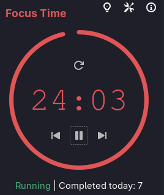

# Pomodoro

Pomodoro timer with a GTK3 window. Single instance, configurable through a plain `.conf` file.



## Features

- Three phases: focus, short break and long break (long break every N focus sessions)
- Window with Start/Pause, Reset, Skip and Reset All (asks for confirmation)
- Beep and desktop notification when a phase ends
- Closing the window pauses the timer
- Opening it again focuses the existing window instead of creating a new one
- Durations, labels, beeps and sound file configurable

## Requirements

- Python 3.10+
- GTK 3 and PyGObject
- `paplay` (PulseAudio/PipeWire) and `notify-send`

Arch Linux:

```sh
sudo pacman -S gtk3 python-gobject libpulse libnotify
```

## Install

From the project root (the folder that contains `src/`):

```sh
mkdir -p ~/.local/bin
python3 -m zipapp src -m "pomodoro.window:show_window" -p "/usr/bin/env python3" -o ~/.local/bin/pomodoro
chmod +x ~/.local/bin/pomodoro
```

Make sure `~/.local/bin` is in your `PATH`. Run the `zipapp` command again after changing the code.

## Usage

```sh
pomodoro
```

| Button      | Action                                              |
|-------------|-----------------------------------------------------|
| Start/Pause | Starts or pauses the current phase                  |
| Reset       | Resets the current phase timer, keeps the count     |
| Skip        | Moves to the next phase (paused)                    |
| Reset All   | Resets phase, timer and completed count (confirms)  |

`Esc` closes the window.

## Configuration

Optional file at `~/.config/pomodoro/pomodoro.conf`. Missing or invalid values fall back to the defaults below. It is read on every launch.

```ini
[durations]      ; minutes
work = 25
short = 5
long = 15

[timer]
cycles = 4       ; focus sessions before a long break

[beeps]          ; beeps played when entering each phase
work = 1
short = 2
long = 3

[labels]
work = Focus
short = Short break
long = Long break

[sound]
file = /usr/share/sounds/freedesktop/stereo/message.oga

[state]          ; optional, where the timer state is stored (~ is accepted)
file = ~/.local/state/pomodoro/state.json
```

The default state file is `$XDG_RUNTIME_DIR/pomodoro.json` (falls back to `/tmp/pomodoro.json` when the variable is not set). Both are cleared on reboot, so the timer and the completed count start from zero after a restart. Point `[state] file` to a persistent path, such as `~/.local/state/pomodoro/state.json`, to keep them. The folder is created automatically.

A phase already in progress keeps its old duration. Run Reset All to apply new durations right away.

## Project structure

```
src/pomodoro/
├── __main__.py   # python -m pomodoro
├── config.py     # defaults and .conf loading
├── state.py      # state file, remaining time, phase advance
├── actions.py    # toggle, pause, skip, reset, reset-all
├── status.py     # phase end detection and status data
├── alerts.py     # beep and notification
└── window.py     # GTK window
```

## How it works

The state (phase, end timestamp, completed count) lives in the state file (see Configuration). While running, the remaining time is computed from the end timestamp, so it stays correct even if the window is busy. The window refreshes every second and, when the timer reaches zero, advances to the next phase, plays the beep and sends a notification. There is no background process: the timer only counts while the window is open.

## Testing light theme

```
cd src
GTK_THEME=Adwaita:light PYTHONPATH=src python -m pomodoro
```